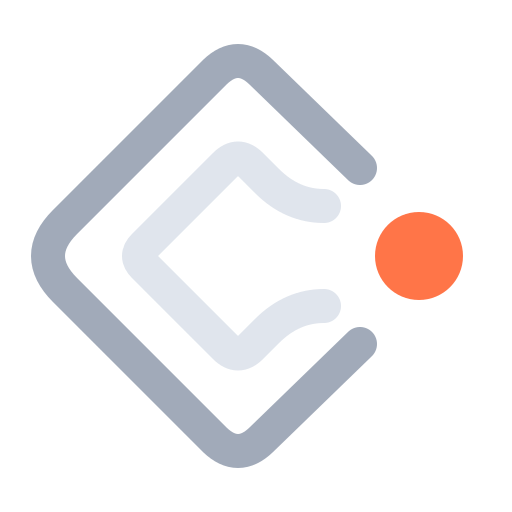
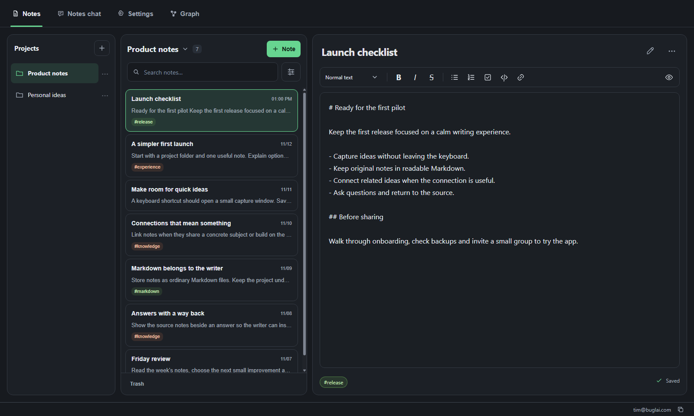
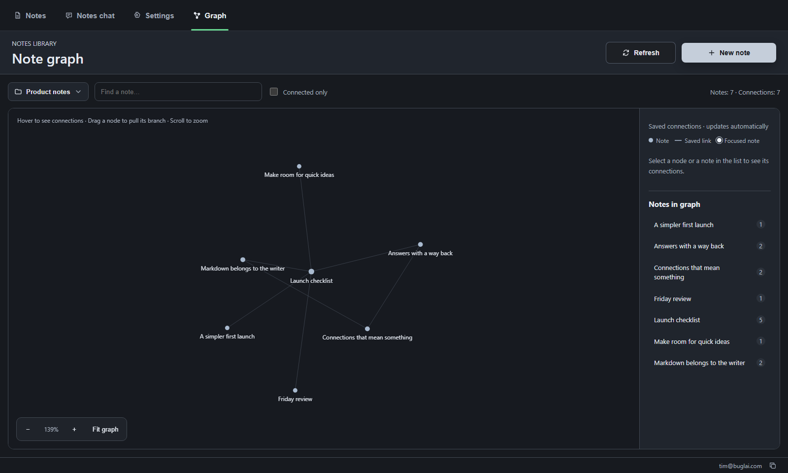
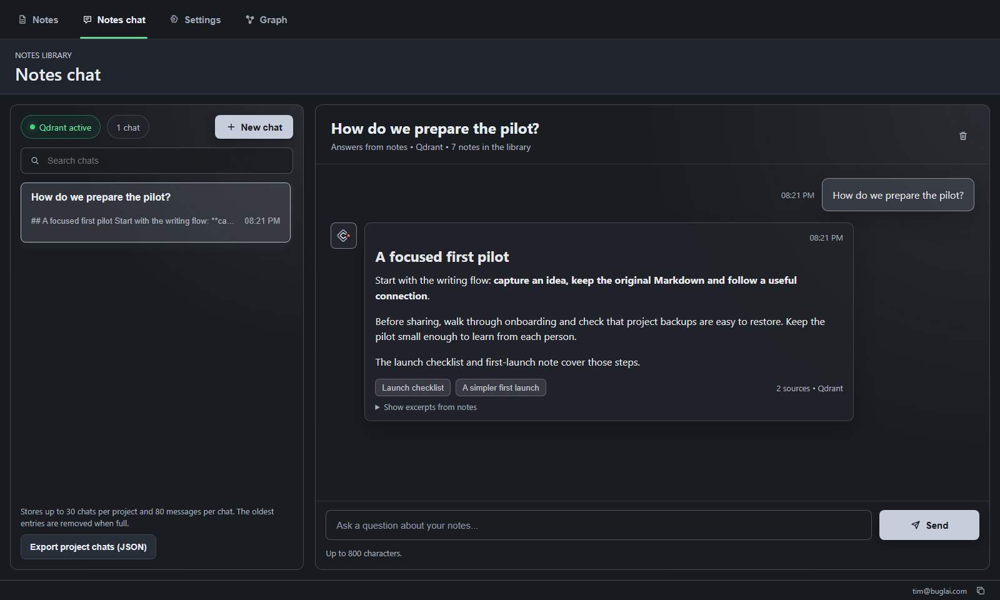

<p align="center">
  
</p>

<h1 align="center">Noda</h1>

<p align="center"><strong>Local AI for your Markdown notes.</strong></p>

<p align="center">Capture an idea. Find its connections. Ask your own library.</p>

<p align="center">Windows x64 · beta · local inference · noncommercial source license</p>

<p align="center"><a href="#build-for-windows">Build for Windows</a> · <a href="docs/USER_GUIDE.md">User guide</a> · <a href="CONTRIBUTING.md">Contribute</a></p>



Noda is a desktop note-taking app for people who want to keep a personal knowledge base in local Markdown files. It combines a quick capture window, an editor, optional AI titles and tags, a knowledge graph, and chat that points back to source notes.

The app runs note processing and chat on your computer using installed models. Initial setup and model downloads require internet access.

## What you can do

| Task | How Noda helps |
| --- | --- |
| Save a thought while working | Open quick capture with `Ctrl + Shift + Space`, type, and press Enter. The queue saves the source before processing. |
| Keep a readable library | Edit a note as soon as you open it. Choose autosave or save changes yourself. |
| Organize without tagging every sentence | Enable AI titles, existing tags, links, and experimental new topics separately. A note can have no tags or links. |
| Keep different subjects apart | Give each project its own Markdown folder, queue, search index and chat history. |
| Follow a connection | Explore saved note links in the graph, then open the related note. |
| Ask a question across your notes | Use local retrieval and chat with clickable source notes and quotations. |

## See your notes in context



The graph displays saved relationships. Shared names or broad topics alone should not force a connection. AI suggestions remain editable metadata.



Chat retrieves note fragments from the current project and includes source links. Check the cited text when accuracy matters; generated answers and metadata can be wrong.

Screenshots use synthetic demo notes in an isolated application profile. The displayed chat answer is demonstration data, not a model evaluation.

## Build for Windows

The prepared source version is **1.0.2-beta.16**. The [source repository](https://github.com/Timaga/noda-local-ai-notes) is currently private for testing. This repository provides source code and a [release draft](docs/releases/1.0.2-beta.16.md). No public, signed installer has been released for this candidate.

You need Windows x64, Git, Node.js 22.12 or newer within the 22.x line, and npm. Clone the repository using an account with access, then build in PowerShell:

```powershell
git clone https://github.com/Timaga/noda-local-ai-notes.git
cd noda-local-ai-notes
npm --prefix frontend ci
npm --prefix frontend run build
```

The build script prints the generated installer path. It uses a dedicated output directory and does not publish the build.

For development checks, see [DEVELOPMENT.md](docs/DEVELOPMENT.md).

### First run

1. Start the installer you built and choose the installation folder.
2. Start in English and create a project or connect a Markdown folder. Other interface languages remain available in Settings.
3. Let Noda prepare its local runtime. Choose the processing models you want, or disable optional AI stages.
4. Create a quick note, watch its queue entry, then open the result in the library.

The base runtime requires Windows 10 or 11 x64 and an AVX2-capable processor. **16 GB RAM is a useful starting point for the recommended local model profile.** Larger models need more resources. Download sizes are shown before model installation; leave additional disk space for the runtime, model weights and temporary downloads.

You can browse, edit and use text search without the semantic search model. Semantic search and note-based chat require their corresponding local models. CPU processing can take minutes; speed depends on the model and the computer.

## Local files, explicit setup

- Notes remain in the project folders you choose, with Markdown content and Noda metadata.
- Windows profile data, including settings and chat history, is kept separately from the project notes.
- The app manages local Python and Qdrant components; models and runtime dependencies are downloaded during setup.
- Noda does not require a hosted model API for its normal local workflow. Model downloads still contact their download providers.
- Project files are not encrypted by Noda. Use your operating system's storage protection and keep backups.

See the [user guide](docs/USER_GUIDE.md) for data locations, project copies and recovery.

## Languages

The interface includes English, Russian, Spanish, French, German, Brazilian Portuguese, Italian, Simplified Chinese, Japanese and Korean. Save a language change and fully restart Noda to apply it. Windows system dialogs follow the Windows language.

The supplied note-processing profiles support **Russian and English**. Changing the interface language does not translate your notes.

## Project status

Noda is a Windows beta. The current focus is reliable capture, useful metadata and a clear local workflow. Broader model evaluation, clean-machine release validation and performance work remain part of beta testing.

Useful contributions include reproducible bugs, accessibility improvements, translations and small tests for real workflows. Please use synthetic notes or remove private information before sharing a report.

## License and credits

Noda's own code is provided under the [PolyForm Noncommercial License 1.0.0](LICENSE). You may use, study, modify and share it for permitted noncommercial purposes under those terms. Commercial use is not granted by this license.

This is **source-available software with a noncommercial restriction**, rather than an OSI open-source license. Third-party code, runtimes, models and assets retain their own licenses; see [THIRD_PARTY_NOTICES.md](THIRD_PARTY_NOTICES.md).

Created by **Tim Buglaev / buglAI**. Support: [tim@buglai.com](mailto:tim@buglai.com). For security reports, follow [SECURITY.md](SECURITY.md).

If Noda is useful to you, a star helps other people discover the project. Reproducible feedback and thoughtful contributions help make the next beta better.
